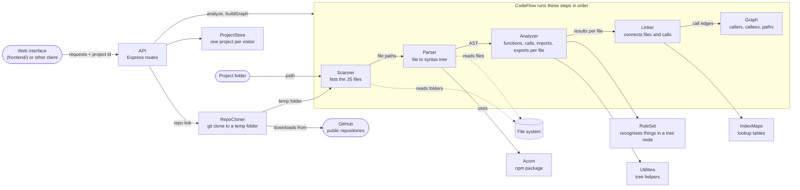

# Architecture diagram

How data moves through the CodeFlow backend. For the written explanation and a
worked example, see [architecture.md](architecture.md).

## Legend

| Box | What it is | Where |
| --- | --- | --- |
| CodeFlow | Front door: runs the steps, returns files, results and errors, builds the Graph | `backend/CodeFlow.js` |
| Scanner | Lists the project's `.js`, `.mjs` and `.cjs` files, skipping `node_modules` and similar | `backend/scanner/` |
| Parser | Reads one file and builds its syntax tree with Acorn, or returns an error | `backend/parser/` |
| Analyzer | Walks one tree and collects functions, calls, imports and exports | `backend/analyzer/` |
| RuleSet | Decides what a single tree node means (function, call, import, export) | `backend/analyzer/rules/` |
| Utilities | Small helpers for walking the tree | `backend/utils/` |
| Linker | Resolves import paths, exports and calls across files | `backend/linker/` |
| IndexMaps | Lookup tables the Linker fills: exports and top-level functions per file | `backend/indexes/` |
| Graph | Answers who calls whom, and finds the shortest call path | `backend/graph/` |
| RepoCloner | Downloads a public GitHub repository with `git clone --depth 1` into a temp folder, and deletes it when replaced | `backend/api/RepoCloner.js` |
| ProjectStore | Keeps one analyzed project per visitor in memory, with a time limit and a size limit | `backend/api/ProjectStore.js` |
| API | Express app that remembers the last analyzed project and serves it as JSON | `backend/api/`, `backend/server.js` |

## Notes

- Data does not pass straight from step to step. `CodeFlow` calls each step and hands the result to the next, so the arrows show the order and the data, not direct calls.
- `Graph` is created on request with `CodeFlow.buildGraph(fileResults)`, after `analyze()` has run. It is not part of `analyze()`.
- The API only analyzes folders inside `ALLOWED_ROOTS` (when set) and only answers browsers from `CORS_ORIGIN`. It keeps the last analyzed project in memory, so one server handles one project at a time. It serves analyze, list functions, get a function, and the callers, callees and path questions answered by `Graph`.
- The web interface (`frontend/`, React) is the main HTTP client. It only talks to the API, never to the engine directly. See [frontend.md](frontend.md).
