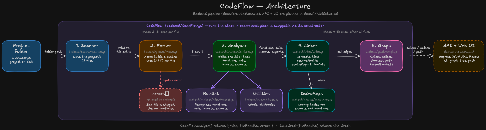

# How CodeFlow fits together

CodeFlow reads a JavaScript project and works out **which function calls which**.
The backend does this in four steps. Each step is one class, and `CodeFlow`
runs them in order. A fifth class, `Graph`, then answers questions about the result.


## The big picture



## What each piece does

| Piece | File | Job | Input | Output |
| --- | --- | --- | --- | --- |
| **CodeFlow** | `backend/CodeFlow.js` | Runs the pipeline and keeps the parts together | A project folder | `{ files, fileResults, errors }` |
| **Scanner** | `backend/scanner/Scanner.js` | Lists the JS files | A folder | Sorted relative paths |
| **Parser** | `backend/parser/Parser.js` | Reads a file and builds its syntax tree with Acorn | A file path | `{ ast }` or `{ error }` |
| **Analyzer** | `backend/analyzer/Analyzer.js` | Walks one tree and collects what it finds | An AST | `{ functions, calls, imports, exports }` |
| **RuleSet** | `backend/analyzer/rules/RuleSet.js` | Recognises functions, calls, imports and exports in one node | One AST node | A list of findings |
| **Utilities** | `backend/utils/Utilities.js` | Small tree helpers (`isNode`, `childNodes`) | AST nodes | Booleans or node lists |
| **Linker** | `backend/linker/Linker.js` | Connects files: imports, exports and calls | All per-file results | Resolved paths, ids and call edges |
| **IndexMaps** | `backend/indexes/IndexMaps.js` | Stores the Linker's lookup tables | Exports and functions per file | Fast lookups |
| **API** | `backend/api/createApp.js` | Exposes analyze, list functions and get a function over HTTP (see [api.md](api.md)) | HTTP requests | JSON |
| **Graph** | `backend/graph/Graph.js` | Answers callers, callees and path questions | Call edges from `linkCalls` | Edges with a `depth`, or a chain of ids |

## Who uses whom

```
CodeFlow ──► Scanner
         ──► Parser
         ──► Analyzer ──► RuleSet
         │            └─► Utilities
         ──► Linker ────► IndexMaps
         └─► Graph  (created by buildGraph from the Linker's edges)
```

- `CodeFlow` is the only piece that knows the whole pipeline. The others never
  call each other, except `Analyzer -> RuleSet/Utilities` and `Linker -> IndexMaps`.
- Every piece can be replaced through the `CodeFlow` constructor, which is how
  tests plug in their own versions.
- Each `Linker` creates its own `IndexMaps`, so two `CodeFlow` instances never
  share data.

## Example, step by step

The test project has three files:

```js
// b.js
export function init() { return helper(); }
export function helper() { return "helper"; }

// c.js
export function init() { return "c"; }
export function helper() { return "c helper"; }

// main.js
import { init as start, helper as helperAlias } from "./c.js";
export function main() { start(); helperAlias(); }
```

1. **Scanner** returns `["b.js", "c.js", "main.js"]`.
2. **Parser** builds a syntax tree for each file.
3. **Analyzer** reads `main.js` and reports:
   - function `main.js#main`
   - imports `start` (is `init` from `./c.js`) and `helperAlias` (is `helper` from `./c.js`)
   - two calls, `start()` and `helperAlias()`, both made by `main.js#main`

   It cannot tell what `start` really is. That needs other files.
4. **Linker** takes all three results and fills `IndexMaps` with each file's
   exports and top-level functions. Then for the call `start()` in `main.js`:
   1. `start` is not a function in `main.js`, but it is an import.
   2. `resolveModule("main.js", "./c.js", files)` gives `c.js`.
   3. `resolveExport("c.js", "init")` gives `c.js#init`.
   4. Result: the edge `main.js#main -> c.js#init`, `confidence: "certain"`.

## Function ids

Every function gets an id made of its file and name, so two functions with
the same name never get mixed up:

| Written as | Id |
| --- | --- |
| `function init()` in `b.js` | `b.js#init` |
| `init()` in `c.js` | `c.js#init` |
| method `run` in `class Svc` in `b.js` | `b.js#Svc.run` |
| code outside any function in `main.js` | `main.js#<top-level>` |
| inline callback on line 7 | `<file>#anonymous@7` |

## Errors

If a file cannot be parsed, the Parser returns `{ error }` instead of an AST.
`CodeFlow.analyze()` adds `{ file, error }` to `errors` and carries on with the
other files, so one broken file never stops the run.

## Not built yet

- API endpoints for callers, callees and paths (the `Graph` class can already answer them).
- The frontend described in `docs/initialSetup.md`.
- Re-exports (`export { x } from "./y"`) and namespace calls (`ns.fn()`).
- Linking classes: `new Scanner()` is not connected to the `Scanner` class, because only functions are indexed.

## Related docs

[scanner.md](scanner.md) · [parser.md](parser.md) · [linker.md](linker.md) · [graph.md](graph.md) · [api.md](api.md) ·
[packages.md](packages.md) · [initialSetup.md](initialSetup.md)
